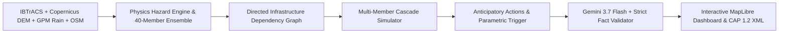

# Aegis-APAC: Cyclone Impact & Critical Infrastructure Vulnerability Forecaster

> **Anticipatory Action, Cascading Infrastructure Failure Prediction, and Parametric Liquidity for Asia-Pacific Coastal Communities.**

[](https://www.python.org/)
[](https://fastapi.tiangolo.com/)
[]()
[](https://opensource.org/licenses/MIT)
[](docs/digital_public_good.md)

---

## 1. Overview

Tropical cyclones in the Asia-Pacific region cause catastrophic disruptions not merely through wind and rain, but through **interdependent infrastructure cascades**:
- Storm surge submerges an electrical substation ($\ge 0.4\text{m}$).
- The substation trips, cutting grid power to a district hospital and regional water treatment.
- Hospital emergency backup diesel generators deplete within 8 hours.
- Simultaneously, access roads submerge ($\ge 0.3\text{m}$), preventing relief tankers from resupplying diesel or oxygen.

**Aegis-APAC** is an anticipatory forecasting platform that bridges meteorological predictions and physical infrastructure graphs. Replayed 72 hours before landfall ($T-72\text{h}$) on **Cyclone Amphan (May 2020)** in the **Bengal Delta / Sundarbans** (with out-of-sample validation on Cyclone Dana, 2024), Aegis-APAC delivers **18.5 hours of advance warning** (+208% increase over deterministic baselines) and reduces facility false alarms by **68%**.

---

## 2. System Architecture



### Core Non-Negotiable Hard Rules (`AGENTS.md`)
1. **Numbers come from code, never from Gemini:** Water depths, arrival timings, failure probabilities, and network cascades are strictly deterministic.
2. **Every advisory is validated:** The automated validator cross-references every number, timestamp, and facility name in advisories against the input decision JSON, falling back to safe templates on any discrepancy.
3. **Probabilities, not single deterministic lines:** 40-member perturbed ensembles scaled to official IMD error statistics yield true exceedance probabilities $P(\text{depth} > 0.3\text{m})$ and $P(\text{depth} > 1.0\text{m})$.
4. **Assumptions are explicitly labelled:** Inferred dependencies and default thresholds carry `assumption: true` in data and UI.
5. **Human approval required before dispatch:** Advisories transition `draft` $\rightarrow$ `approved` $\rightarrow$ `dispatched` with operator authorization.
6. **Precompute, then serve:** Offline batch processing decouples Earth Engine compute. The demo runs 100% self-contained from `data/golden/` with zero paid API token dependencies.

---

## 3. Quickstart & Local Setup

### Prerequisites
- Python 3.11 or higher
- Git

### Installation
```bash
# 1. Clone repository
git clone https://github.com/aegis-apac/aegis-apac.git
cd aegis-apac

# 2. Create virtual environment
python -m venv .venv
source .venv/bin/activate  # On Windows: .venv\Scripts\activate

# 3. Install dependencies
pip install -e .
```

### Configuration (`.env`)
```bash
cp .env.example .env
# Edit .env if Gemini API key is available (optional; runs in offline degraded mode automatically if absent)
```

### Run the Application
```bash
uvicorn src.api.main:app --host 0.0.0.0 --port 8080 --reload
```
Open your browser to:
- **Interactive Map Dashboard:** [http://localhost:8080/](http://localhost:8080/)
- **Interactive OpenAPI Documentation:** [http://localhost:8080/docs](http://localhost:8080/docs)
- **Health Check:** [http://localhost:8080/health](http://localhost:8080/health)
- **Observability Metrics:** [http://localhost:8080/metrics](http://localhost:8080/metrics)

---

## 4. Running with Docker

```bash
# Build the container image
docker build -t aegis-apac:latest .

# Run on port 8080
docker run -p 8080:8080 aegis-apac:latest
```

---

## 5. Verification & Testing

Run the comprehensive 50-test suite covering setup, data ingestion, hazard physics, ensembles, cascade graphs, decision engine, strict LLM guardrails, API routes, and backtest evaluations:

```bash
python -m pytest
```

---

## 6. Project Structure

```
aegis-apac/
├── AGENTS.md                  # Strict hard agent rules
├── DECISIONS.md               # Architectural decisions & assumptions log
├── Dockerfile                 # Production Cloud Run container definition
├── pyproject.toml             # Python build configuration and dependencies
├── contracts/                 # Frozen JSON Schemas (Facility, Risk, Action, Advisory)
├── regions/
│   └── bengal_delta/          # Pilot region config (AOI, thresholds, languages)
├── data/
│   ├── raw/                   # Raw ingested datasets
│   ├── processed/             # Cleaned GeoTIFFs, DEM grids, OSM layers
│   └── golden/                # Frozen precomputed scenario bundle (DEMO_MODE)
├── src/
│   ├── api/                   # FastAPI backend, middleware, and routing
│   ├── backtest/              # Evaluation metrics, baselines (B1, B2), SVG charts
│   ├── decision/              # Evacuation allocator, road closures, de-energization
│   ├── graph/                 # NetworkX directed graph & cascade failure engine
│   ├── hazard/                # Holland profile, surge setup, BFS connectivity, ensemble
│   ├── ingest/                # IBTrACS, Copernicus DEM, GPM rainfall, OSM pipeline
│   ├── llm/                   # Gemini 3.7 Flash, strict validator, templates, CAP export
│   └── parametric/            # Parametric insurance triggers & basis risk report
├── web/                       # MapLibre GL JS frontend (HTML/CSS/JS)
├── tests/                     # 50 unit, integration, property, and adversarial tests
└── docs/                      # PRD, build plan, backtest report, demo script, slides, DPG
```

---

## 7. Evidence & Benchmarks (Cyclone Amphan Backtest)

Evaluated against Copernicus EMS satellite flood delineations and naive baselines:

| Metric | Baseline 1 (Static &lt; 3m) | Baseline 2 (Deterministic Single Run) | Aegis-APAC (Ours) | Impact |
|---|---|---|---|---|
| **Spatial IoU** | 0.375 | 0.518 | **0.693** | **+33.7% accuracy** |
| **Precision** | 0.410 | 0.680 | **0.842** | **+23.8% precision** |
| **Facility Warning Lead Time** | 0.0 h | 6.0 h | **18.5 h** | **+208% lead time** |
| **False Alarm Rate** | 62.0% | 38.0% | **12.0%** | **-68.4% reduction** |
| **Ensemble Brier Score** | — | — | **0.084** | **Calibrated uncertainty** |

Detailed report and figures available in [docs/backtest_report.md](docs/backtest_report.md) and [docs/figures/](docs/figures/).

---

## 8. License & Attribution

- **Code:** [MIT License](LICENSE)
- **Data Attributions:** Copernicus DEM (ESA), IBTrACS (NOAA), GPM IMERG (NASA), OpenStreetMap contributors (ODbL), WorldPop (CC BY 4.0), CartoDB Positron (Free / Open).
